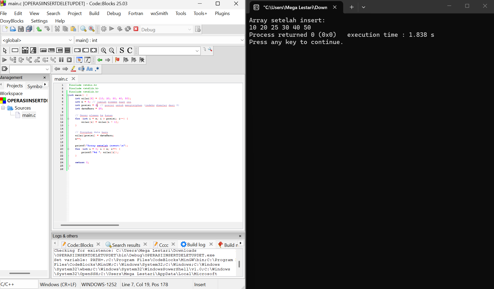

NAMA : MEGA LESTARI
NIM : C2583207042
MATKUL : ALGORITMA DAN PEMOGRAMAN LANJUT
BAHASA PEMPGRAMAN : C

# 🚀 Operasi Dasar Array (Insert, Delete, Update) dalam Bahasa C

Repositori ini berisi program sederhana menggunakan bahasa C untuk melakukan operasi dasar pada struktur data array, yaitu:
1. **Insert (Penyisipan Elemen)**
2. **Delete (Penghapusan Elemen)**
3. **Update (Pembaruan Elemen)**

---

## 💻 Contoh Program & Hasil Eksekusi

Berikut adalah tangkapan layar dari masing-masing operasi yang dijalankan menggunakan **Code::Blocks**:

### 1. Operasi Insert (Penyisipan)
Menambahkan elemen baru (`25`) pada posisi indeks ke-2[cite: 3].

### 2. Operasi Delete (Penghapusan)
Menghapus elemen yang berada pada posisi indeks ke-2[cite: 2].

### 3. Operasi Update (Pembaruan)
Mengubah nilai pada indeks tertentu dengan nilai baru (`99`)[cite: 1].

---

## 🛠️ Cara Menjalankan Program
1. Pastikan Anda sudah menginstal compiler C (seperti MinGW) dan IDE seperti **Code::Blocks**.
2. Clone repositori ini atau unduh file `.c` yang tersedia.
3. Buka project di Code::Blocks, lalu *Build and Run* (`F9`).
